# Trip Insurance

Trip Insurance is a single-trip travel insurance PoC that pays out automatically when a trip goes wrong. A traveler requests a policy with a cost NFT that proves the booking, and investors split the 100 shares of that policy through an ascending auction. The contract judges and pays from an observation signed by an oracle.


## Flow

A policy moves through joining, the auction, judging and settlement.

### Join

The traveler sets a premium, a cost NFT, a coverage condition and a minimum coverage, and requests a policy.


### Auction

Investors bid a coverage amount per share, and the highest bids receive the 100 shares first. Each investor pays what they bid, and unallocated deposits return on claim.


### Judging

The contract accepts only the signature of the oracle named in the condition. A met condition pays out, an unmet condition expires the policy, and a missing judgment voids it.


### Settlement

The premium minus a 2% fee goes to investors in proportion to their shares. Every amount accrues to a per-address balance, and each party withdraws it.



## Architecture

One contract handles every policy. The mock issuer and the mock oracle only sign and never decide asset movements. State changes that follow a deadline run on the first call after it.



## Demo

The GitHub Pages site opens with the slide deck, and the demo screens run on the Base Sepolia testnet (deployment pending). A participant scans the QR on the demo slide and enters a name. The browser then creates a temporary wallet, and the presenter sends it ETH for bidding.

```text
https://hab56ur9.github.io/trip-insurance/           Slides
https://hab56ur9.github.io/trip-insurance/demo/      Invest and join
https://hab56ur9.github.io/trip-insurance/demo/buy/  Buy
https://hab56ur9.github.io/trip-insurance/docs/      PRD and tech doc
```

## Run locally

Local runs need Foundry and Node 20 or later.

```bash
git submodule update --init --recursive && npm install
forge test && npm run e2e
./script/local-up.sh
python3 -m http.server 8099 --bind 127.0.0.1
```

```text
Invest   http://127.0.0.1:8099/ui/
Buy      http://127.0.0.1:8099/ui/buy/
Slides   http://127.0.0.1:8099/ui/deck.html
```

## Documents

```text
docs/prd.html    Requirements
docs/tech.html   Architecture, methods, limits and trade-offs
AGENTS.md        Guide for agents working in this repository
```
