# Trip Insurance

> This repository is a demo project built as the final project for a blockchain course. It runs only on local chains and testnets, and it is not a real insurance product.

Trip Insurance is a single-trip travel insurance PoC that pays out automatically when a trip goes wrong. A traveler requests a policy with a cost NFT that proves the booking, and investors split the 100 shares of that policy through an ascending auction. The contract judges and pays from an observation signed by an oracle.



## Demo

The demo site holds the slide deck and the demo screens on the Base Sepolia testnet. The site explains how to take part in the demo.

**[hab56ur9.github.io/trip-insurance](https://hab56ur9.github.io/trip-insurance/)**

## Agent Plugin

This repository supports an agent plugin for Claude Code and Codex. The plugin runs the demo and supports development.

Claude Code installs the plugin with two commands.

```text
/plugin marketplace add hab56ur9/trip-insurance
/plugin install trip-insurance@trip-insurance
```

Codex adds the marketplace, and the plugin installs from `/plugins`.

```text
codex plugin marketplace add hab56ur9/trip-insurance
```

## Flow

A policy moves through joining, the auction, judging and settlement.

### Join

The traveler sets a premium, a cost NFT, a coverage condition and a minimum coverage, and requests a policy.



### Auction

Investors bid a coverage amount per share, and the highest bids receive the 100 shares first. Each investor pays what they bid, and unallocated deposits return on claim.



### Judging

The contract accepts only the signature of the oracle named in the condition. A met condition pays out, an unmet condition expires the policy, and a missing judgment voids it.



### Settlement

The premium minus a 2% fee goes to investors in proportion to their shares. Every amount accrues to a per-address balance, and each party withdraws it.


## Architecture

One contract handles every policy. The mock issuer and the mock oracle only sign and never decide asset movements. State changes that follow a deadline run on the first call after it.


